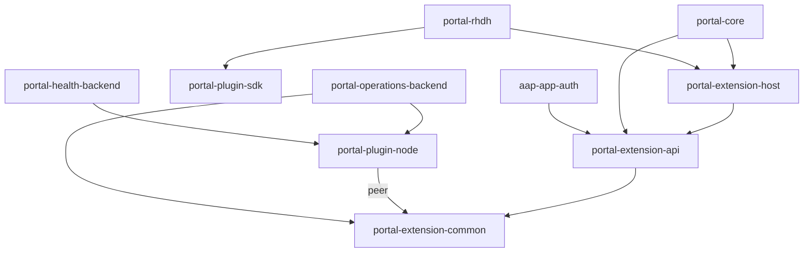

# Portal SDK npm package readiness

This document proposes the npm publication scope for third-party developers
building Portal plugins in their own repositories. It inventories the packages
and records local packaging checks. It does not announce a release, promise a
supported platform matrix, or authorize publishing.

The inventory uses repository baseline `a3ee4523` plus the packaging changes in
this branch, with Backstage `1.54.9`, Backstage CLI `0.36.5`, Yarn `4.12.0`,
and RHDH CLI `1.10.8`.

## Publication scope

Publish the SDK libraries and supporting packages needed to author and host
external contributors. Feature plugins from the AAP, APME, content management,
and content development workspaces are outside this publication proposal.

Authors install only the libraries their contributor imports. Host packages are
installed by the application maintainer. The SDK does not require every author
to install a host, an authentication backend, or the existing feature plugins.

### SDK and host libraries

All five currently have version `0.1.0`, `private: true`, and
`publishConfig.access: public`. Public access metadata does not override the
private publication guard.

- **`@ansible/portal-extension-common`** — shared manifest, contribution, operation,
  and content-type contracts. No internal runtime package dependencies.
- **`@ansible/portal-extension-api`** — frontend contribution APIs, native
  blueprints, API references, and registration helpers. Depends on
  `portal-extension-common`. Native entry point: `/alpha`.
- **`@ansible/portal-plugin-sdk`** — reusable React components, hooks, styling,
  notifications, and presentation utilities. No internal runtime package
  dependencies. Optional for contributors that do not use its UI helpers.
- **`@ansible/portal-plugin-node`** — backend plugin helpers, identity context,
  operations, entitlements, audit, and health services. Requires
  `portal-extension-common` as a peer dependency. Optional for frontend-only
  contributors.
- **`@ansible/portal-extension-host`** — host rendering, validation, contribution
  composition, and discovery. Depends on `portal-extension-api`. Native entry
  point: `/alpha`. This is a host-maintainer dependency, not a normal
  contributor-author dependency. It is grouped with libraries for packaging,
  but should not be presented as an author prerequisite.

### Host and runtime plugins

All four currently have version `0.1.0` and `private: true`. Each is a proposed
supporting package, not a dependency every contributor must declare.

- **`@ansible/portal-core`** — native frontend host and navigation. Depends on
  `portal-extension-api` and `portal-extension-host`. Exposes `/alpha` and
  `/app-nav` in addition to its root entry point.
- **`@ansible/portal-rhdh`** — RHDH global-header adapter. Depends on
  `portal-extension-host` and `portal-plugin-sdk`. Exposes `/alpha`. Its RHDH
  header dependency remains outside the generic author SDK.
- **`@ansible/portal-operations-backend`** — backend operation dispatch. Depends
  on `portal-extension-common` and `portal-plugin-node`. Exposes `/alpha`.
  Install when the host needs the Portal operation API.
- **`@ansible/portal-health-backend`** — backend health aggregation. Depends on
  `portal-plugin-node`, whose common-contract peer must also be available.
  Install when the host needs the Portal health API.

### Optional frontend authentication package

**`@ansible/aap-app-auth`** currently has version `0.1.0` and `private: true`.
It exports `rhAapAuthApiRef` for consumers needing the user's AAP credentials,
and `/alpha` supplies the native sign-in and profile contribution module.
It depends on `portal-extension-api` for the profile contribution.

A consumer importing the auth API reference does not need to directly depend
on the other SDK packages or feature plugins. Its package manager still resolves
the auth package's declared transitive dependencies. The host must provide the
configured frontend AAP auth API, the
`@ansible/backstage-plugin-auth-backend-module-rhaap-provider` backend module,
and `auth.providers.rhaap` configuration. Publishing or installing the frontend
package alone does not supply these host prerequisites.

The current `/alpha` module registers an AAP-only sign-in page as well as the
API. Before release, make API registration usable independently and keep the
Portal sign-in page and logout integration opt-in. Validate coexistence with
standard RHDH sign-in. The packaging changes in this branch do not implement
that UI separation.

The backend provider is an existing host prerequisite, not part of the initial
ten-package packing candidate set. If publishing that backend becomes necessary,
its current internal runtime dependency chain is:

- `@ansible/backstage-plugin-auth-backend-module-rhaap-provider` (`2.3.1`)
  depends on `@ansible/backstage-rhaap-common` (`2.3.1`) and
  `@ansible/aap-common` (`0.1.0`).
- `@ansible/backstage-rhaap-common` also depends on `@ansible/aap-common`.
- All three currently have `private: true`. Their existing versions must not be
  reset or aligned with SDK preview versions without reviewing release history.
- Automatic catalog-user provisioning additionally needs the host's provisioning
  module and catalog configuration. It is not implied by installing an npm
  auth library.

## Internal dependency map

Arrows mean a package declares a runtime dependency, except the labeled peer.
This is an npm dependency map, not frontend activation or backend startup order.
External Backstage, React, Express, and RHDH dependencies are omitted.



The internal dependency closure for these ten candidates contains no feature
plugin packages. Publish or otherwise make dependencies available before their
dependents, including the common-contract peer required by the backend SDK.

For a frontend contribution, the smallest internal dependency chain is
`portal-extension-api` and `portal-extension-common`. Add `portal-plugin-sdk`
only for its UI helpers. A backend author using `portal-plugin-node` must also
provide its `portal-extension-common` peer. Host composition packages are
separate from those author dependencies.

The generic contribution SDK remains usable without AAP authentication. Scaffolder
field libraries in content development are not included in the first scope.
Include those reusable libraries only if an external author's agreed use case
requires them. This does not add the Portal scaffolder feature plugin to npm scope.

## Packaging findings

Local checks use freshly emitted TypeScript declarations, package builds, and
`yarn workspace <package> pack --out <temporary-path>`. These commands create
local tarballs only. They do not publish to npm or a container registry.

### Confirmed SDK library checks

The five libraries above build and pack locally. Their packed manifests resolve
root entry points, declared export subpaths, and declaration paths to files
present in the archive. Internal runtime and peer dependency ranges become
`^0.1.0` rather than retaining `workspace:` references.

Source manifests pointing to `src/` are not by themselves a publication defect.
The installed Backstage prepack hook rewrites entry points to built artifacts,
and postpack restores the source manifests. Inspect the generated archive instead
of rewriting source exports solely because they point to TypeScript.

All ten candidate archives retain `private: true`, preventing publication, and
keep their existing `0.1.0` versions. Each contains a `LICENSE` file identical
to the repository Apache-2.0 license. The earlier missing-license finding is
resolved for the candidate packages. This checks the repository license text,
not third-party dependency licenses, required third-party notices, or security
approval.

### Supporting plugin checks

All five supporting plugins now build and pack with the required metadata:

- `portal-core`, `portal-rhdh`, `portal-operations-backend`, and
  `portal-health-backend` each declare `backstage.pluginPackages` with their
  own package name. No other package in this repository declares the same
  respective plugin ID.
- `aap-app-auth` declares `backstage.pluginPackage: '@backstage/plugin-app'`,
  matching the native `app` plugin it extends. The module's misleading plural
  `pluginPackages` entry is removed.

All ten tarballs passed checks that declared `main`, `module`, `types`, export,
and configuration-schema targets exist. Runtime and peer dependencies contain
no `workspace:`, `file:`, `link:`, or `portal:` references. Each tarball includes
its license and retains the private guard. Archive file lists contain no
`.env`, `.git`, `node_modules`, or `app-config*.yaml` files. These filename checks
are not a secret-content scan or a substitute for security review.

All ten candidate builds and the root TypeScript declaration emission passed on
Node `22.22.3`. The separate packed-consumer checks below also passed. Dynamic
exports, dependency vulnerability scanning and dependency-license review are
separate release checks.

### Separate packed-consumer checks

A fresh consumer project outside this monorepo installed all ten candidate
archives on 2026-11-06, using Yarn `4.12.0` and the Node `22.22.3` runtime. It had
its own manifest and lockfile, with no workspace links or inherited root lockfile.
Internal `@ansible` dependencies were resolved to the candidate tarballs through
explicit consumer resolutions because these candidates are not yet published.
The declared external peers were installed explicitly. The consumer pinned the
reference host's `@backstage/core-app-api@1.20.4` context and used RJSF `5.24.13`
peers to satisfy the host package's declared ranges.

The following checks passed:

- TypeScript compilation of a native frontend contributor using the public
  profile-item blueprint and generic SDK UI components, plus a backend
  contributor using the backend SDK and health service reference.
- Compilation of host/auth root and subpath imports, including native entry
  points and the Portal navigation entry point.
- Browser bundles of the frontend contributor and host/auth imports, resolving
  their dependency graphs from installed archives.
- Runtime import of the backend host features and an SDK health push/read check.
- All ten internal package paths resolve inside the isolated consumer's
  `node_modules`. Browser bundle inputs contain no monorepo source paths.

These checks validate installation, selected public API use, bundling and a
bounded backend runtime path. They do not validate live host discovery, API
identity across independently bundled dynamic plugins, permissions, operation
execution, AAP login/logout, or RHDH installation. Consumer TypeScript compilation
used `skipLibCheck: true`, so it is not a full third-party declaration audit.

Lifecycle scripts were disabled during the consumer install. Packages requiring
native build scripts were not exercised. The install completed with Material UI 4
peer-range warnings against React 18 and its types. Record and review these
warnings when choosing the release compatibility matrix; a successful install
does not resolve that compatibility question.

## Reproducing the candidate packing checks

### Prerequisites

- Install repository dependencies with the configured Yarn version.
- Use Node 22 or 24, as declared by the repository.
- Run the commands from the repository root.

### Procedure

1. Emit declarations using the current checkout:

   ```bash
   yarn tsc
   ```

2. Build and pack all ten candidates into a temporary directory:

   ```bash
   set -e
   package_artifacts="$(mktemp -d)"
   for package in portal-extension-common portal-extension-api portal-plugin-sdk portal-plugin-node portal-extension-host portal-core portal-rhdh portal-operations-backend portal-health-backend aap-app-auth; do
     yarn workspace "@ansible/$package" build
     yarn workspace "@ansible/$package" pack --out "$package_artifacts/$package.tgz"
   done
   ```

### Verification

Confirm that each command exits successfully. Inspect an archive's published
metadata and file list, including any subpath declaration files:

```bash
tar -xOf "$package_artifacts/portal-extension-api.tgz" package/package.json
tar -tzf "$package_artifacts/portal-extension-api.tgz"
```

Resolve every `main`, `module`, `types`, and export target against the archive
contents. Check internal runtime and peer dependency ranges, license files,
notices, and unintended files. Repeat for each archive. A successful local pack
does not remove the private publication guard or validate a real host install.

## Release decisions and acceptance gates

1. **Approve the package allowlist.** Start with the five libraries, distinguish
   host-only consumers, and confirm which supporting plugins need npm delivery
   for the first external integration. Keep feature plugins excluded.
   Freeze the intended public API before cutting artifacts. This inventory's
   baseline still contains the experience-ID contract that
   [the removal PR](https://github.com/ansible/ansible-backstage-plugins/pull/1061)
   changes. Repeat packing and consumer checks on the selected merged release
   revision rather than releasing these baseline artifacts unchanged.
2. **Choose versions and tags.** Current `0.1.0` values are ordinary versions,
   not SemVer prereleases. Decide whether to use an explicit prerelease such as
   `0.1.0-alpha.0` with a `next` tag. Specify compatible internal ranges and the
   relationship between npm package versions and dynamic OCI artifacts.
3. **Finalize publishable metadata and contents.** The initial metadata and
   repository-license gaps are fixed and tarballs pass local checks. Remove
   the private guard only
   for approved packages, supply required plugin metadata, and include licenses
   and notices. Validate root and subpath imports and configuration schemas from
   the packed files.
4. **Validate host authentication composition.** Separate AAP API registration
   from opt-in sign-in and logout UI, document the required host backend module
   and configuration, and test standard RHDH coexistence. Do not treat a
   successful auth-package pack as proof of this behavior.
5. **Complete separate-consumer runtime validation.** Packed installation,
   selected frontend/backend compilation, browser bundling and a backend SDK
   runtime smoke check have passed outside the monorepo. Next verify live host
   discovery, shared API identity, permissions, operations and required AAP
   authentication using the selected release artifacts. The bounded checks above
   do not prove those host behaviors.
6. **Agree compatibility.** Backstage `1.54.9` is the source baseline. Previous
   local RHDH testing against `next-2.1` is not a supported-version declaration.
   Record an immutable RHDH image digest and test the actual release candidates.
   Validate peers rather than widening their ranges based only on a successful
   monorepo build.
7. **Agree secure publication.** Confirm `@ansible` namespace ownership, authorized
   maintainers, CI publisher identity, provenance, dependency and license checks,
   package-content checks, and release approval with the relevant maintainers.
   These controls are not established by this inventory.
8. **Onboard dynamic plugins separately.** The proposed RHDH path uses export
   overlays for OCI packaging and validation. SDK libraries themselves do not
   become installable dynamic plugins. Onboarding access and packaging ownership
   remain to be confirmed before implementing a release workflow.

## Related guidance

- [Plugin author guide](portal-sdk-plugin-author-guide.md)
- [Native frontend composition](portal-sdk-nfs-composition.md)
- [Out-of-tree plugin obligations](../adrs/third-party/028-out-of-tree-plugin-obligations.md)
- [Yarn workspace dependency publication](https://yarnpkg.com/features/workspaces#cross-references)
- [Yarn pack](https://yarnpkg.com/cli/pack)
- [Backstage package metadata](https://backstage.io/docs/tooling/package-metadata/)
- [Backstage build and packaging system](https://backstage.io/docs/tooling/cli/build-system/)

The author guide and out-of-tree ADR predate this publication work. Update their
in-tree preview restrictions and provisional install instructions together with
an accepted external-consumption contract, rather than treating this inventory
as an already available npm installation path.
