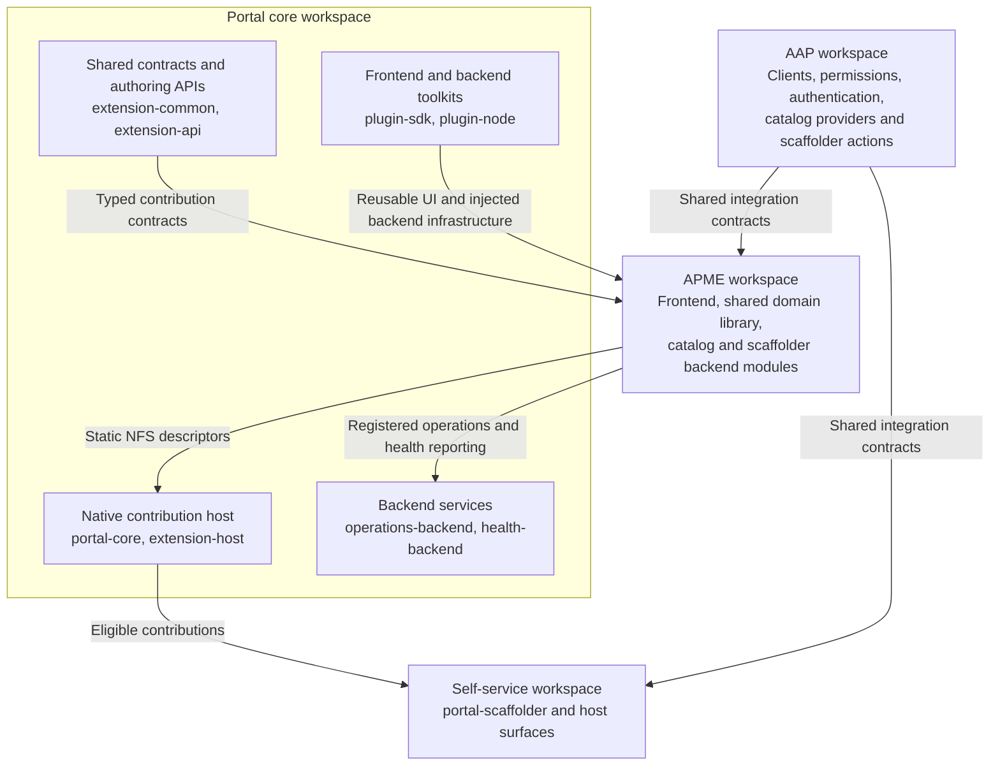

# Workspaces — Portal plugin architecture

Packages are grouped by ownership under one root Yarn workspace configuration
and lockfile. These directories are not independently installed Yarn projects.

```text
workspaces/
├── portal-core/
│   ├── packages/app/           Native development app and legacy fallback
│   ├── packages/backend/       Development backend composition
│   └── plugins/                Contracts, host, SDKs, operations, health
├── portal-scaffolder/plugins/  Portal scaffolder and current content pages
├── aap/plugins/                AAP clients, auth, catalog, provisioning, actions
├── apme/plugins/               Third-party contribution example and backend modules
└── content/plugins/            Automation content over OCI registries (PoC)
```

## Workspace relationships

Arrows show runtime contributions and shared-contract consumption, not an
exhaustive dependency graph or dynamic-plugin load order.



Self-service does not import APME's implementation. It consumes host adapters
that render eligible native descriptors. The SDK does not need to know APME's
domain rules.

## Package responsibilities

### Portal core

- `portal-extension-common`: shared manifest, capability, launch, operation,
  entitlement and content-type contracts.
- `portal-extension-api`: native Blueprints, stable NFS data references,
  frontend API references and clients. Registry helpers are legacy compatibility.
- `portal-extension-host`: validation, filtering, rendering adapters, error
  boundaries, theme-token wrappers and RJSF settings-shell utilities.
- `portal-core`: installs app-scoped contribution/operation/entitlement APIs;
  its navigation module adapts discovered pages to configured navigation.
- `portal-plugin-sdk`: reusable frontend components and utilities.
- `portal-rhdh`: optional adapter to RHDH's public header Blueprint for
  contributed profile-menu items. It has no AAP dependency;
  AAP auth owns its opt-in Sign out contribution. Generic SDK contracts do not import it.
- `portal-plugin-node`: injected backend services and helpers for operations,
  identity/context, audit, organization and health.
- `portal-operations-backend`: authenticated operation transport and
  server-resolved entitlement decisions.
- `portal-health-backend`: aggregated backend health endpoint.

Native composition does not depend on a shared mutable
`ContributionRegistry`, module-load registration, or a `portal-core` MF
singleton. Library packages are not standalone page plugins.

### Self-service

`@ansible/portal-scaffolder` owns templates, tasks, authoring and picker
integration. It also currently hosts collection, repository and execution-
environment browsing/detail pages pending content extraction.

### APME

- `backstage-apme` directory: `@ansible/plugin-backstage-apme` native frontend.
- `backstage-apme-common`: domain types, clients and operation descriptors.
- `catalog-backend-module-apme`: catalog integration and registered domain operations.
- `scaffolder-backend-module-apme`: repository-registration scaffolder action
  delegating to an APME-owned operation.

The frontend declares Quality, activity, dependencies, overview cards, actions,
catalog extensions, workflows and fields through its static `./alpha` entry
point. Contributor code owns components and domain behavior; the host owns
eligibility and layout.

### AAP

The AAP group contains the shared integration library, frontend plugin,
catalog module, authentication provider, user-provisioning module and scaffolder
module. Backend code uses AAP clients/services; frontend surfaces communicate
through platform APIs rather than directly contacting AAP.

### Content

- `automation-content`: `@ansible/plugin-automation-content` frontend mounted
  at `/automation-content`; a drill-down content browser (execution
  environment → collection → content item → documentation) built on the Portal
  SDK.
- `automation-content-backend`: content API — discovery, documentation and
  requirements resolution over OCI registries.
- `automation-content-common`: OCI client, capability probe, digest cache and
  the two-axis adapter contracts.
- `catalog-backend-module-automation-content`: catalog entity provider syncing
  registry content into the catalog.
- `content-model`: content manifest and content object model.
- `content-type-execution-environment`: execution-environment content-type
  adapter.

Proof-of-concept status: interfaces, config shape, API routes and entity shape
still move without notice. See `content/README.md` and `content/docs/adrs/`.

## Current boundaries

- Native NFS is the source app default; legacy registration is an explicit fallback.
- Operations receive the selected subject, not a manifest-supplied handler URL.
- Health reporting is backend-only in the deployed composition. A host health
  component exists but is not installed as a dashboard.
- Registered operations enforce trusted organization context and declared
  entitlements. APME interactive workflows also authorize repository access.
  Remaining legacy mutations and automatic scan policy still need migration;
  frontend gates are not backend authorization.
- The AAP resolver validates current memberships against configured organizations.
  Any granted membership enables a shared capability, subject to RBAC. Shared
  Git repositories have no mandatory AAP owner; new manual entries use `default`.
  Multiple memberships do not select an active organization for tenant-specific
  handlers. No organization selector is provided.
- Query/write contracts and content extraction remain separate work.
- Packed acceptance was bounded to `next-2.1`; published preview compatibility
  and release delivery are not complete.

## Documentation

- [SDK architecture and Mermaid runtime diagrams](../docs/next/portal-sdk-architecture.md)
- [Third-party plugin author guide](../docs/next/portal-sdk-plugin-author-guide.md)
- [Native NFS integration](../docs/next/portal-sdk-nfs-composition.md)
- [Implementation scope and remaining architecture](../docs/next/portal-plugin-factory-implementation-guide.md)
- [Portal package overview](portal-core/plugins/README.md)
