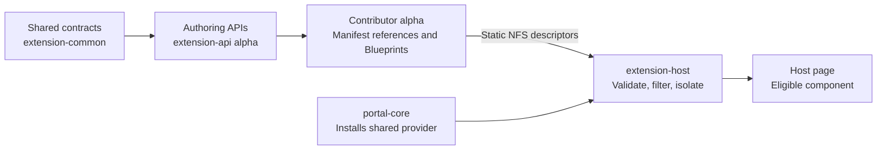
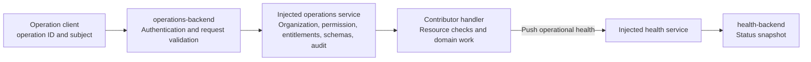

# Portal core and SDK packages

These packages separate shared contracts, frontend contribution authoring,
host rendering, reusable UI, and backend infrastructure. They support native NFS
composition; they do not require a global contribution registry singleton.

## Package responsibilities

- **`portal-extension-common`** — frontend/backend vocabulary: manifests,
  capabilities, launches, operation descriptors, entitlements and content types.
  New shared metadata must remain serializable; executable native predicates
  belong on frontend descriptors.
- **`portal-extension-api`** — frontend API refs/clients and native
  Blueprint/data-reference contracts through `./alpha`. Root exports also
  retain explicit legacy registry helpers; these are not native registration.
- **`portal-extension-host`** — contribution validation, filtering, rendering,
  error boundaries, theme-token wrappers and the RJSF settings-shell utility.
- **`portal-core`** — installs shared frontend APIs, including
  `api:portal/contributions`, and provides the configured navigation adapter.
  It is not a Module Federation singleton registry provider.
- **`portal-plugin-sdk`** — shared UI, notifications, caching, context hooks,
  polling integration, styles, icons and theme utilities.
- **`portal-rhdh`** — optional public RHDH header adapter for contributed
  profile-menu items; generic contracts remain platform-neutral.
  AAP auth owns its opt-in Sign out contribution, without an adapter dependency on AAP.
- **`portal-plugin-node`** — injected operation, entitlement, organization and
  health services; identity/context, audit and persistence helpers.
- **`portal-operations-backend`** — operation HTTP transport and entitlement
  decisions. Contributors register handlers through the injected root service.
- **`portal-health-backend`** — aggregates pushed status at
  `GET /api/portal-health/status`.

## Frontend composition

NFS descriptors connect through stable data-reference IDs. The host owns
eligibility and the layout; the contributor owns its component and domain facts.
Scaffolder fields use the native templates-page input rather than the
entity/catalog provider input. Shared UI helpers do not register contributions.

Use existing host surfaces rather than adding duplicate `/portal/*` pages.
The source app explicitly retains a legacy fallback, which must not be installed
alongside the contributor's native registration path.

## Backend composition

Operation descriptors do not contain arbitrary handler URLs. A descriptor must
also have a registered backend handler. The dispatcher verifies trusted
organization context, permission, declared entitlements, and schemas;
contributor handlers must authorize resources and apply domain checks.

Health is a separate backend reporting flow. `PortalHealthStatus` is an
available host component, not an installed dashboard or global indicator.
`SettingsShell` is an available form utility, not proof that all generic
settings contribution routing/persistence is implemented.

## Preview limitations

Operation transports and APME interactive workflows resolve trusted memberships
from the injected host service, not identity namespace. The AAP adapter validates
direct/team memberships against configured organizations. Any granted membership
enables a shared capability, subject to RBAC. New manual Git repository entries
use `default`, with no AAP ownership annotation or catalog namespace mapping;
existing records are not rewritten. Declared operation entitlements are enforced
server-side; configuration grants do not prove membership or replace RBAC.
Organization-specific handlers still need one validated organization rather
than an arbitrary choice from multiple memberships. Frontend context comes from
authenticated `GET /api/portal-operations/context`, not the user namespace.
Remaining legacy mutations, automatic scan policy, and organization switching
are separate work.

Structured audit emission is not durable audit storage. Idempotency metadata
does not install a persistent retry-key mechanism. Common launch types do not
imply every slot/workflow/follow-on combination is implemented.

The implementation has been exercised on packed `next-2.1` with mock AAP auth and
separately with real AAP in the source app. These checks do not establish a
supported package release or complete content migration.

## Documentation and author entry points

- [SDK architecture](../../../docs/next/portal-sdk-architecture.md)
- [Third-party plugin author guide](../../../docs/next/portal-sdk-plugin-author-guide.md)
- [Native NFS composition](../../../docs/next/portal-sdk-nfs-composition.md)
- [Delivered scope and remaining architecture](../../../docs/next/portal-plugin-factory-implementation-guide.md)
- [Frontend authoring API](../../../docs/plugins/portal-extension-api.md)
- [Backend SDK](../../../docs/plugins/portal-plugin-node.md)
- [Theme-adaptive design tokens](../../../docs/next/portal-sdk-design-tokens.md)
